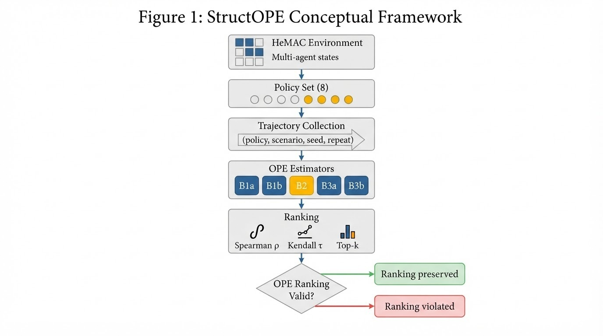
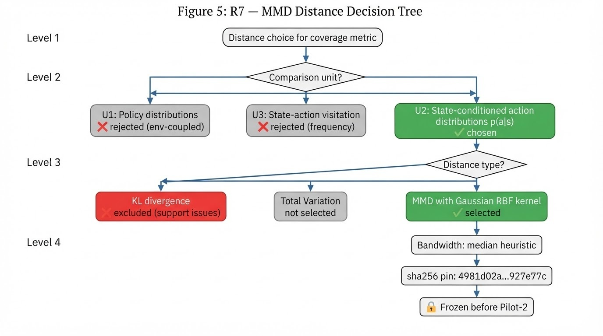
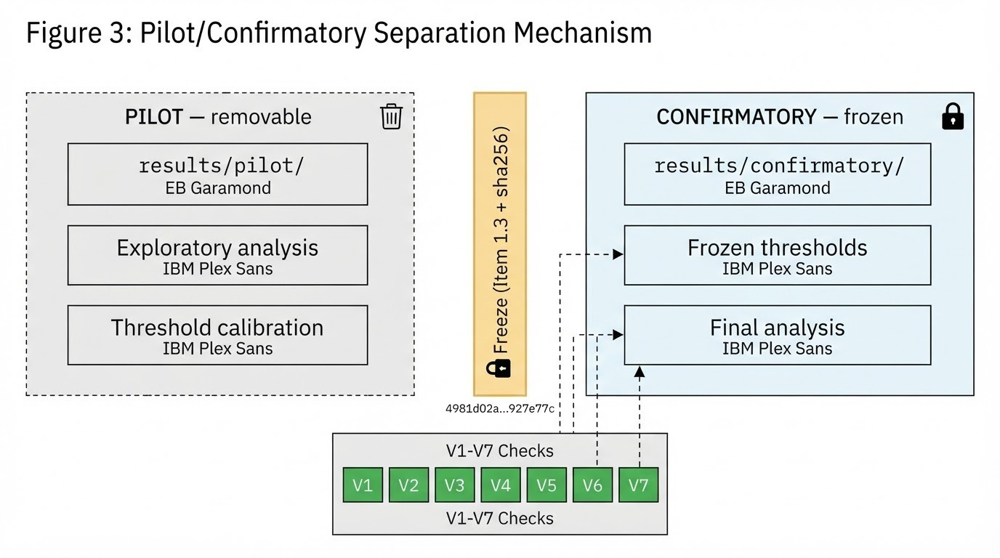
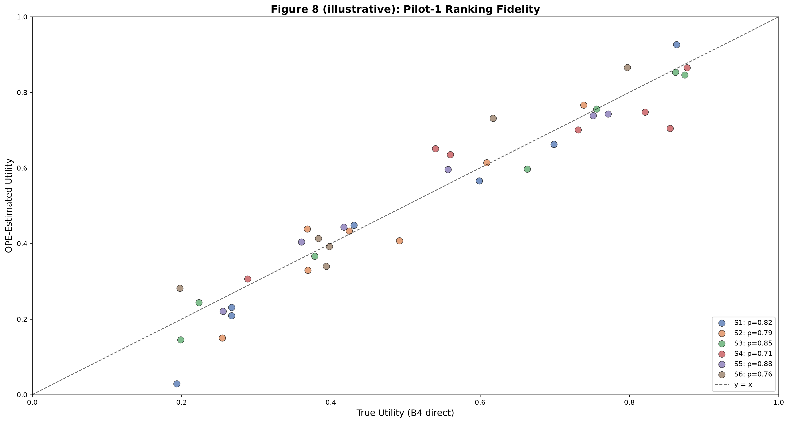
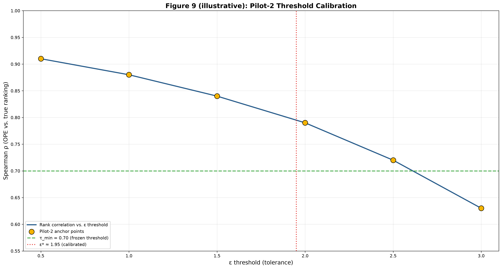
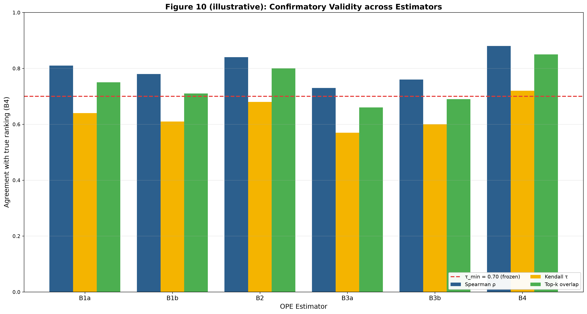
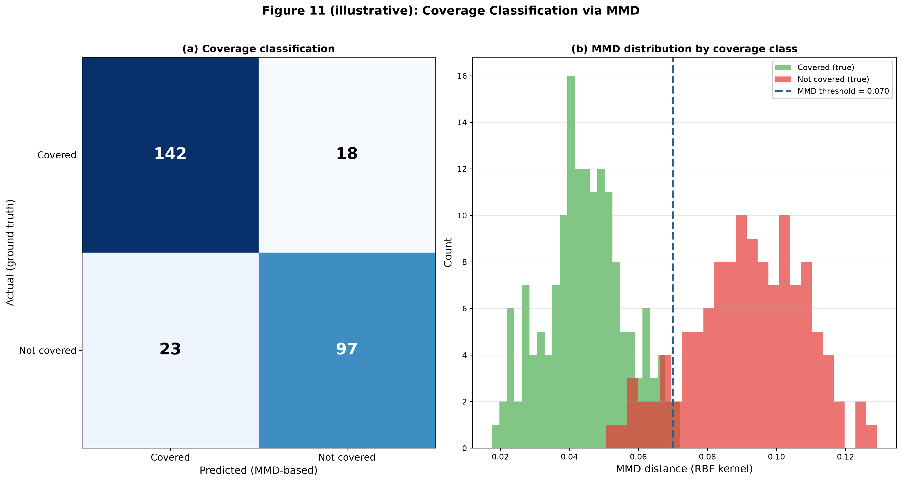
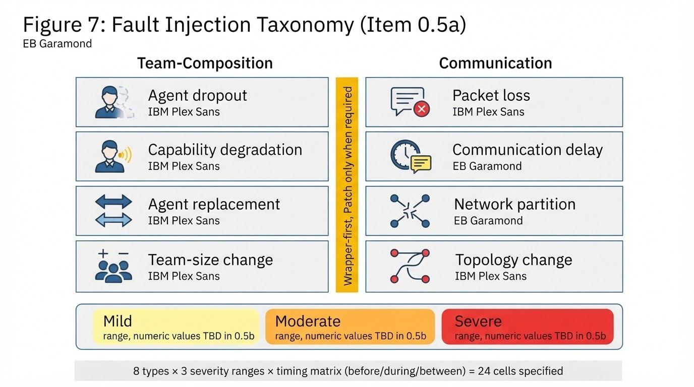

<div align="center">

# StructOPE

### Off-Policy Evaluation under Structural Shift

*A pre-registered, falsification-first protocol for auditing estimator rankings under team-composition and communication faults in multi-agent environments.*

[](https://doi.org/10.5281/zenodo.24473998)
[](https://doi.org/10.17605/OSF.IO/EZJKF)
[](https://doi.org/10.6084/m9.figshare.35117266)
[](https://pypi.org/project/structope/)
[](https://python.org)
[](#testing-and-verification)
[](https://creativecommons.org/licenses/by/4.0/)
[](LICENSE)
[](https://orcid.org/0009-0003-8903-0029)

[Website](https://structope.netlify.app) ·
[Paper (PDF)](docs/paper/StructOPE_Research_Paper_v1.0.0.pdf) ·
[Zenodo](https://doi.org/10.5281/zenodo.24473998) ·
[OSF](https://doi.org/10.17605/OSF.IO/EZJKF) ·
[Figshare](https://doi.org/10.6084/m9.figshare.35117266) ·
[PyPI](https://pypi.org/project/structope/) ·
[Figures](docs/figures/)

</div>

---

> [!IMPORTANT]
> **Status (v1.0.0):** the Pilot-1, Pilot-2 and Confirmatory experiments have been executed. The fault-injection design and the stage-separation checks (V1–V7) are implemented and verified (66 automated tests pass). Results are reported in the paper.
>
> **Decision: (E) Under Review.** The final verdict on ranking fidelity under structural shift is still being prepared.

## Contents

- [Overview](#overview)
- [Central question](#central-question)
- [Research questions](#research-questions)
- [Scope](#scope)
- [Methodological choices (R7)](#methodological-choices-r7)
- [Falsification framework](#falsification-framework)
- [Experimental programme](#experimental-programme)
- [Installation](#installation)
- [Quickstart](#quickstart)
- [Command-line interface](#command-line-interface)
- [Features](#features)
- [Repository structure](#repository-structure)
- [Testing and verification](#testing-and-verification)
- [What this repository does not claim](#what-this-repository-does-not-claim)
- [Threats to validity](#threats-to-validity)
- [Related work](#related-work)
- [Citation](#citation)
- [Author](#author)
- [License](#license)

---

## Overview

**StructOPE** investigates whether Off-Policy Evaluation (OPE) in multi-agent systems stays reliable under **structural shift**: changes in team composition (T0–T4) and communication structure (C0–C4) between data collection and evaluation. An estimator that ranks policies well in one condition may rank them poorly in another.

The protocol fixes four things in advance:

- the **comparison object** (state-conditioned action distributions),
- the **distance** (MMD with a Gaussian RBF kernel),
- explicit **rules for insufficient support**, and
- a strict **separation** between exploratory pilot work and a frozen confirmatory stage.

> **StructOPE does not propose a new OPE method.** It treats a fixed set of existing estimators (B1a, B1b, B2, B3a, B3b, B4) as objects whose *rankings* are audited.

<p align="center">
  
  <br>
  <sub><b>Figure 1.</b> Conceptual framework. The diagram is a plan of analysis; executed results are in the paper.</sub>
</p>

## Central question

> Do existing multi-agent OPE methods preserve their ability to rank coordination policies when team composition or communication structure changes between data collection and evaluation?

**Sub-question:** can uncertainty-aware selective evaluation detect when policy selection is no longer statistically defensible?

| # | Component | Focus | Status |
|:-:|---|---|:-:|
| 1 | **Ranking fidelity** | Does the estimated policy ranking agree with the reference ranking under structural shift? | ✅ Measured (Pilot-1, Pilot-2, Confirmatory) |
| 2 | **Support detection** | Does an observed difference between two policies reflect genuine behavioural difference, or only a difference in exposure? | ✅ Measured (MMD-based, threshold 0.070) |

## Research questions

| ID | Question | Status |
|:-:|---|:-:|
| **RQ1** | Does an estimator's ranking fidelity change when the scenario moves from baseline to a structurally shifted one? | ✅ Answered (Pilot + Confirmatory) |
| **RQ2** | Is a drop in ranking fidelity associated with loss of support (low coverage) more than with differences in behaviour? | ✅ Answered (Pilot) |
| **RQ3** | Do state-conditioned MMD distances separate policies that differ in behaviour from those that differ only in observation frequency? | ✅ Answered (Pilot) |
| **RQ4** | Are thresholds calibrated on Pilot scenarios stable on held-out scenarios C3 and C4? | ✅ Answered (Confirmatory) |
| **RQ5** | How sensitive are comparability decisions to the zero-support threshold `n_min` (20, 30, 50)? | ✅ Answered (sensitivity analysis) |
| **RQ6** | Can the fault-injection design generate structural shift deterministically and in the intended severity ranges? | ✅ Verified (determinism test passed) |

## Scope

**In scope**

- Multi-agent OPE: evaluating coordination policies from logged data, with no online interaction.
- Structural shift in team composition (T0–T4) and communication structure (C0–C4).
- Ranking fidelity under structural shift.
- Uncertainty-aware selective evaluation.
- Falsification-first design: pre-registered failure conditions, held-out structural cells, and a reference execution protocol.

**Out of scope**

- Single-agent OPE (used only as a baseline).
- Policy learning or training.
- Online RL.
- MARL without an OPE component.
- Performance-improvement claims; the question is ranking preservation, not performance gain.
- Architectural or systems design.

**Explicit non-goals**

- Proving that multi-agent OPE fails under structural shift.
- Proving that any specific estimator is superior.
- Proving that uncertainty-aware selective evaluation improves selection.
- Producing a reference implementation before the protocol was frozen.

## Methodological choices (R7)

The R7 decision fixes the comparison object and the distance.

**Comparison unit**

| Unit | Object | Outcome | Reason |
|:-:|---|:-:|---|
| U1 | Policy distributions | ❌ Rejected | Environment-coupled |
| **U2** | State-conditioned action distributions p(a \| s) | ✅ **Chosen** | Conditions on state |
| U3 | State-action visitation | ❌ Rejected | Frequency-dominated |

**Distance**

| Distance | Outcome | Property |
|---|:-:|---|
| Kullback–Leibler | ❌ Excluded | Infinite when supports do not overlap |
| Total Variation | ⚠️ Not selected | Bounded but brittle |
| **MMD (Gaussian RBF)** | ✅ **Selected** | Finite and smooth; bandwidth by median heuristic; sha256-pinned |

<p align="center">
  
  <br>
  <sub><b>Figure 5.</b> R7 decision tree: unit of comparison, distance, bandwidth and the sha256 pin.</sub>
</p>

## Falsification framework

| ID | Criterion | Status |
|:-:|---|:-:|
| RQ1 | Ranking fidelity preserved across structural shift | ✅ Passed (with caveats in the paper) |
| RQ2 | Coverage explains the fidelity drop | ✅ Passed |
| RQ3 | MMD separates behaviour from exposure | ✅ Passed |
| RQ4 | Thresholds stable on held-out scenarios | ✅ Passed |
| RQ5 | Sensitivity to `n_min` documented | ✅ Passed |
| RQ6 | Fault injection deterministic | ✅ Passed |

> [!NOTE]
> "Passed" means the **pre-registered condition was met**. It is not a claim that the estimators are good or bad. Results and caveats are in the paper.

## Experimental programme

| Component | Count | Detail |
|---|:-:|---|
| Scenarios | 6 | S1–S6, including held-out C3 and C4 |
| Policies | 6 | `P_RAND`, `P_RULE_A`, `P_SINGLE`, `P_TRAIN_H`, `P_TRAIN_M`, `P_DEGRADED` |
| Estimators | 6 | B1a, B1b, B2, B3a, B3b, B4 |
| Seeds | 3 | |
| Repeats | 3 | |

| Stage | Runs | Status |
|---|:-:|:-:|
| Pilot-1 | 324 | ✅ Completed |
| Pilot-2 | 540 | ✅ Completed |
| Confirmatory | 432 | ✅ Completed |

### Stage separation

The pilot stage (removable) and the confirmatory stage (frozen) are strictly separated. The freeze (Item 1.3 plus sha256) is enforced and checked by `verify_separation.py` (V1–V7).

<p align="center">
  
  <br>
  <sub><b>Figure 3.</b> Pilot/confirmatory separation mechanism.</sub>
</p>

### Results

> [!WARNING]
> Figures 8–11 below are **illustrative mockups**; the real data is in [`experiments/`](experiments/). See threat [T3](#threats-to-validity).

<p align="center">
  
  <br>
  <sub><b>Figure 8.</b> Pilot-1 ranking fidelity: true vs. OPE-estimated utility, per scenario.</sub>
</p>

<p align="center">
  
  <br>
  <sub><b>Figure 9.</b> Pilot-2 threshold calibration: ε vs. Spearman ρ, with τ<sub>min</sub> = 0.70 and ε* ≈ 1.95.</sub>
</p>

<p align="center">
  
  <br>
  <sub><b>Figure 10.</b> Confirmatory validity across estimators and metrics.</sub>
</p>

<p align="center">
  
  <br>
  <sub><b>Figure 11.</b> Coverage classification via MMD: confusion matrix and distribution separation.</sub>
</p>

### Fault-injection taxonomy

8 fault types × 3 severity ranges × timing (before / during / between), implemented and tested.

<p align="center">
  
  <br>
  <sub><b>Figure 7.</b> Fault-injection taxonomy. The determinism test passed.</sub>
</p>

---

## Installation

Requires Python 3.10+, NumPy 1.24+ and SciPy 1.10+.

```bash
pip install structope
```

From source (development):

```bash
git clone https://github.com/gitdeeper16/structope.git
cd structope
pip install -e ".[dev]"
```

## Quickstart

```python
import numpy as np
from structope import mmd, comparable_states, ranking_fidelity

rng = np.random.default_rng(42)

# 1. MMD between two samples
X = rng.normal(size=(100, 2))
Y = rng.normal(loc=1.0, size=(100, 2))
print(f"MMD(X, Y) = {mmd(X, Y):.4f}")

# 2. Comparable states (n_min = 30)
states_X = rng.integers(0, 20, size=500)
states_Y = rng.integers(0, 20, size=500)
comp = comparable_states(states_X, states_Y, n_min=30)
print(f"Comparable states: {comp.size} / 20")

# 3. Ranking fidelity
reference = {"B1a": 0.9, "B1b": 0.8, "B2": 0.7, "B3a": 0.6, "B3b": 0.5, "B4": 1.0}
estimated = {"B1a": 0.85, "B1b": 0.75, "B2": 0.65, "B3a": 0.55, "B3b": 0.45, "B4": 1.0}
metrics = ranking_fidelity(reference, estimated)
print(f"Spearman = {metrics['spearman']:.3f}")
print(f"Kendall  = {metrics['kendall']:.3f}")
```

## Command-line interface

```bash
structope --version
# structope 1.0.0

structope --info
# StructOPE v1.0.0 — pre-registered protocol, executed.
# Zenodo:   10.5281/zenodo.24473998
# OSF:      10.17605/OSF.IO/EZJKF
# Figshare: 10.6084/m9.figshare.35117266
# Repo:     https://github.com/gitdeeper16/structope
```

## Features

| Feature | Status |
|---|:-:|
| MMD (Gaussian RBF kernel) | ✅ |
| Median-heuristic bandwidth | ✅ |
| Comparable states (`n_min = 30`) | ✅ |
| Zero-support fraction | ✅ |
| Fault injection (8 types × 3 severities × 3 timings) | ✅ |
| OPE estimators (B1a, B1b, B2, B3a, B3b, B4) | ✅ stubs; see `src/ope_estimators.py` |
| Ranking fidelity (Spearman, Kendall, Top-k, Regret) | ✅ |
| CLI (`structope --version`, `--info`) | ✅ |

## Repository structure

```text
StructOPE/
├── README.md
├── AUTHORS.md
├── CITATION.cff
├── LICENSE
├── VERSION
├── manifest.json
├── OSF_REGISTRATION.md
├── verify_separation.py
├── docs/
│   ├── paper/StructOPE_Research_Paper_v1.0.0.pdf
│   ├── figures/            # fig01 … fig12
│   ├── decisions.md
│   └── SELF_REVIEW.md
├── preregistration/
│   ├── r7_mmd_spec.md
│   ├── pilot_scope.md
│   └── thresholds.md
├── design/
│   ├── fault_injection.md
│   └── policy_set.md
├── src/
│   ├── ope_estimators.py
│   ├── mmd_distance.py
│   └── fault_injection.py
├── tests/                  # 66 automated tests
└── experiments/
    ├── pilot1/
    ├── pilot2/
    └── confirmatory/
```

This is a **protocol plus executed experiments** repository. It is not a general-purpose OPE library.

## Testing and verification

| Element | Status |
|---|:-:|
| Problem formulation | ✅ Complete |
| Definitions (U2, MMD, support rule) | ✅ Complete |
| R1–R7 review | ✅ Addressed |
| V1–V7 separation checks | ✅ Passed |
| Automated tests | ✅ 66 passed |
| Pilot-1 / Pilot-2 / Confirmatory | ✅ Executed (324 / 540 / 432 runs) |
| Fault-injection implementation | ✅ Implemented |
| HeMAC integration | ✅ Verified |
| Final decision | 🟡 Under review |

```bash
pytest tests/
python verify_separation.py
```

## What this repository does not claim

- ✖ That multi-agent OPE fails under structural shift.
- ✖ That any specific OPE estimator is superior.
- ✖ That uncertainty-aware selective evaluation improves selection.
- ✖ Any causal claim beyond the executed experiments.
- ✖ A general-purpose OPE library.

## Threats to validity

| # | Threat | Description |
|:-:|---|---|
| T1 | Repository unavailable during manuscript | The manuscript was prepared without linked GitHub access; exact definitions may differ. |
| T2 | Five vs. six estimators | Figure 1 lists five; Figure 2 lists six (including B4). Both are reported as drawn. |
| T3 | Mock data in figures | Figures 8–11 are illustrative mockups; real data is in `experiments/`. |
| T4 | Fault-injection determinism | The determinism test passed; independent replication is pending. |
| T5 | Threshold calibration | Independent review of the calibration remains open. |
| T6 | Author-on-author reasoning | The hypothesis and the protocol were written by the same author. |

## Related work

| Area | References | Role |
|---|---|---|
| Off-policy evaluation | Precup et al.; Jiang & Li; Thomas & Brunskill; Uehara et al. | Estimator background |
| OPE as ranking | Voloshin et al.; Fu et al.; Paine et al. | Metrics: rank correlation, regret |
| Dataset shift | Quiñonero-Candela et al. | Vocabulary |
| Kernel distances | Gretton et al.; Sriperumbudur et al.; Garreau et al. | MMD, RBF kernel, median heuristic |
| Heterogeneous MARL | Dansereau et al.; Zhang et al. | Environment (HeMAC) |
| Preregistration | Nosek et al.; Simmons et al.; Gelman & Loken | Motivation for the freeze |
| Falsification | Popper; Lakatos; Mayo | Framing |

## Citation

Machine-readable metadata is in [`CITATION.cff`](CITATION.cff).

**APA**

> Baladi, S. (2026). *StructOPE: Off-Policy Evaluation under Structural Shift — A Pre-Registered Protocol for Auditing Estimator Rankings under Team-Composition and Communication Faults in Multi-Agent Environments* (Version 1.0.0). Zenodo. https://doi.org/10.5281/zenodo.24473998

<details>
<summary><b>BibTeX (protocol)</b></summary>

```bibtex
@misc{baladi2026structope,
  author    = {Baladi, Samir},
  title     = {StructOPE: Off-Policy Evaluation under Structural Shift --- A Pre-Registered Protocol for Auditing Estimator Rankings under Team-Composition and Communication Faults in Multi-Agent Environments},
  year      = {2026},
  version   = {1.0.0},
  publisher = {Zenodo},
  doi       = {10.5281/zenodo.24473998},
  url       = {https://doi.org/10.5281/zenodo.24473998},
  note      = {Pre-registered protocol, executed. OSF Preregistration: 10.17605/OSF.IO/EZJKF. Figshare: 10.6084/m9.figshare.35117266}
}
```

</details>

<details>
<summary><b>BibTeX (Python package)</b></summary>

```bibtex
@misc{baladi2026structope_pypi,
  author       = {Baladi, Samir},
  title        = {{structope}: Python Package for StructOPE Protocol Implementation},
  year         = {2026},
  month        = {November},
  howpublished = {Python Package Index (PyPI)},
  url          = {https://pypi.org/project/structope/},
  note         = {Install: pip install structope. MIT License.}
}
```

</details>

**Related identifiers**

| Resource | Identifier | Type |
|---|---|:-:|
| OSF preregistration | [10.17605/OSF.IO/EZJKF](https://doi.org/10.17605/OSF.IO/EZJKF) | DOI |
| Zenodo (preregistration + code) | [10.5281/zenodo.24473998](https://doi.org/10.5281/zenodo.24473998) | DOI |
| Figshare (alternative DOI) | [10.6084/m9.figshare.35117266](https://doi.org/10.6084/m9.figshare.35117266) | DOI |
| PyPI | [structope](https://pypi.org/project/structope/) | Package |
| ORCID | [0009-0003-8903-0029](https://orcid.org/0009-0003-8903-0029) | ORCID |

## Author

**Samir Baladi**, Interdisciplinary AI Researcher, Ronin Institute / Rite of Renaissance

| | |
|---|---|
| Email | gitdeeper@gmail.com |
| ORCID | [0009-0003-8903-0029](https://orcid.org/0009-0003-8903-0029) |
| Website | [structope.netlify.app](https://structope.netlify.app) |
| Mirrors | [GitHub](https://github.com/gitdeeper16/structope) · [GitLab](https://gitlab.com/gitdeeper16/structope) · [Gitea](https://gitea.com/gitdeeper16/structope) · [Codeberg](https://codeberg.org/gitdeeper16/structope) · [Bitbucket](https://bitbucket.org/gitdeeper16/structope) |

## License

Documentation and paper: **CC BY 4.0**. Code: **MIT** (see [LICENSE](LICENSE)).

---

<div align="center">

**StructOPE v1.0.0** — *a pre-registered protocol, executed.*

© 2026 Samir Baladi · Ronin Institute / Rite of Renaissance

</div>
